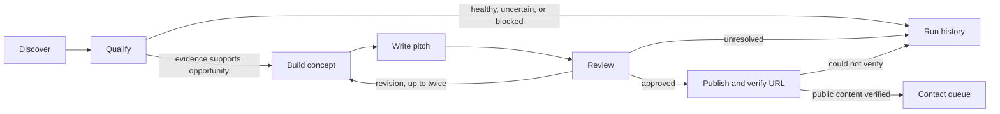

# SiteScout

SiteScout is a research assistant for an independent web designer. It discovers licensed painting businesses in Los Angeles or Orange County, checks whether customers can reach them online, and prepares a website concept and a personalized outreach draft when the evidence supports one. Abraham decides whether to make contact.

**Open the operator desk** to see real businesses ready to contact, their verified preview links and the published ways to reach them. **Run discovery** starts live research. **Runs** lets you inspect a batch, play its recording, or try the ten-business rehearsal. **How it works** plays one business’s recorded path through the graph. A new checkout includes a fictional rehearsal that works without API keys.

For the presentation on the prepared Mac, open [Runs](http://127.0.0.1:8501/?view=runs) → **Run options → Start live showcase** to follow Color-Me-Custom through fresh research. To inspect the original Orange County decisions, [replay the saved batch](http://127.0.0.1:8501/?replay=c2b2a6384c70&at=1) or [advance through Color-Me-Custom’s recorded handoffs](http://127.0.0.1:8501/?view=workflow&run=c2b2a6384c70&business=595143). The [original business record](http://127.0.0.1:8501/?run=c2b2a6384c70&business=595143) shows the eight retrieved passages and the draft. A [later recheck](https://p-0802103d19d41a1766.sitescout-previews-ec8f1c9e.pages.dev/) found the business logo in its gallery.

An earlier discovery trial produced a reviewed phone follow-up for a Long Beach painter. The [current JMN concept](https://p-50cddcce849716ddb3.sitescout-previews-ec8f1c9e.pages.dev) shows six project photos and four independently attributed reviews. Open the [ten real businesses on the prepared Mac](http://127.0.0.1:8501/?run=6372a8b0d5db). [BE Painting](https://p-dc3948d7e16d9df62f.sitescout-previews-ec8f1c9e.pages.dev) shows the business’s logo, five project photos and two attributed Google reviews. [Tony Castaneda](https://p-9405c26f8241177248.sitescout-previews-ec8f1c9e.pages.dev) shows five Instagram project photos with links to the original posts. For a predictable walkthrough, use the [fictional ten-business rehearsal](http://127.0.0.1:8501/?replay=3fb08b205b01).

## Open the desk

On Abraham’s prepared Mac, double-click **Open SiteScout.command** in Finder. It opens the desk and keeps it running if you close Terminal or Codex. After signing back in or restarting the Mac, double-click it again. Saved runs and contacts appear in the same desk. To run the dashboard in the foreground instead, use these commands and open **http://127.0.0.1:8501** in a browser.

```sh
cd /Users/abe/agent/cmu-agentic-ai/sitescout-capstone
.venv/bin/streamlit run app.py
```

On a new Mac or Linux checkout, use Python 3.12 with SQLite FTS5 support. The following uses [uv](https://docs.astral.sh/uv/). Standard Python 3.12 with `python3.12 -m venv .venv` and `.venv/bin/python -m pip install -r requirements.txt` works too.

```sh
git clone https://github.com/Abraham21/sitescout-capstone.git
cd sitescout-capstone
uv venv --python 3.12
uv pip install -r requirements.txt
.venv/bin/streamlit run app.py
```

### Use the desk

| View | What you can do |
| --- | --- |
| Contact queue | Open a draft to see one business immediately. Its preview, contact details and editable message are together. **Back to queue** returns to the same status group. After reaching out, use **Mark contacted**. **Dismiss lead** sets a business aside. The Contacted and Dismissed views keep the date and the saved draft. **Restore lead** lets the latest research determine whether it returns to the ready list. |
| Runs | Choose a recorded batch or follow a running one. Select a business in the activity list or use **Inspect business**. Business rows switch the detail panel in place. The URL keeps the selection for sharing or reloading. Up to three businesses can be in progress. |
| How it works | Pick a business and play, step back or advance through its actual handoffs, including a skipped lead, a reviewer hold or a repair when present in the selected run. |

**Run discovery** starts with painters who received a dated customer review, then verifies their licenses and researches their websites. Under **Runs → Run options**, the live showcase starts with Color-Me-Custom and three other real licenses. It looks up their current registry records, checks any supplied listing, and runs the same qualification, build, writing and review steps as fresh discovery. The rehearsal exercises ten fictional cases, and Daily autopilot controls the Mac’s schedule. A saved replay uses historical decisions and drafts. You can select and copy its text. Current reviewed drafts can be edited from the contact queue.

Open a business to see the research decision above its draft and preview. **Website preview** shows how it was customized. **Research & RAG** shows the research passages and which ones retrieval selected or the qualifier cited. **Agent trace** retains the handoffs and reviewer feedback. A person chooses whether and how to send each message.

## Read the code

Start with [pipeline.py](pipeline.py). Read `run_lead` from the node definitions through the graph edges. Each node returns the few fields it adds to the business record. Read `run_batch` second to see where the businesses and tools come from. To trace a hold, follow `search_business` → `inspect_site` → the return value of `qualify` in [research.py](research.py). To trace a published lead, follow `build_preview` → `write_pitch` → `review` in [studio.py](studio.py). The same graph powers the command line, dashboard and scheduled run. Its nodes and conditional edges follow the StateGraph pattern from Module 5.1. The researcher uses the course sample’s approach of bounded queries, deduplicated sources and direct page checks. Checkpoint 2.1 proposed exposing tools through MCP. By Checkpoint 5.1, discovery was a tool step feeding four agents in one LangGraph process. In the final implementation the graph calls the tools directly, and SQLite stores shared evidence and traces. One process owns retries and spending reservations. The Module 2.2 MCP pattern would fit a future external client that needs access to this evidence.



| File | Where to look |
| --- | --- |
| [activity_intake.py](activity_intake.py) | `discover` reads dated Yelp reviews via Yahoo Local, matches the painter to one active license, and selects unseen candidates. |
| [research.py](research.py) | Reads the public CSLB file. `qualify` checks the business’s identity, possible websites and contact paths, then retrieves evidence for the model. |
| [business_profile.py](business_profile.py) | Reads gallery photos, logos and attributed review text from matched business sources. Checks image type and size before embedding. |
| [studio.py](studio.py) | `build_preview` fills the painter template. `write_pitch` compares grounded openings. `review` rebuilds the HTML, verifies the claims and asks Gemini for a separate judgment. |
| [assets/painter.html](assets/painter.html) | The painter layouts display the business phone, verified services, available photos and sourced testimonials. Service cards lead to the estimate form and preselect the project type when the business offers multiple verified specialties. **Send request** demonstrates how the owner could activate inquiries. Contact details stay in the browser. The [painter skill](.agents/skills/painter-preview/SKILL.md) explains which facts and images may appear. |
| [services.py](services.py), [publication.py](publication.py) | The Gemini and Exa calls, followed by direct upload to Cloudflare Pages and a check of the HTML actually served. |
| [storage.py](storage.py), [autopilot.py](autopilot.py) | SQLite stores events, results, spending reservations and operator edits. macOS launchd schedules one batch per day when enabled. |
| [app.py](app.py), [desk_views.py](desk_views.py) | The Streamlit operator desk, recorded graph playback, and evidence inspection. |
| [evaluation.py](evaluation.py) | Reproduce fixture, retrieval, writing and blind-review measurements. |

### How a lead earns a preview

1. Discovery searches public Yahoo Local painting directories in the selected county. Los Angeles is the default (36 cities and communities). To search Orange County (40), choose **Runs → Run options → Discovery market**. Daily autopilot uses the same setting. When a directory card has reviews and a phone, SiteScout checks its number or trade name against active C-33 registry records before reading the full listing. It verifies the business identity and a dated Yelp review from the past 365 days. A painter whose listing and registered address are in different covered cities can enter research when the trade name is exact and the published phone belongs to a single active in-scope license. Before using that listing alone as the basis for a portfolio pitch, the researcher requires the license number on the listing or confirmation from another business profile. The trace distinguishes the two localities. SiteScout spends search credits on up to the requested number of unseen candidates with a reason to investigate. Signals include a listing without a company website, a missing or expired listed website, a broken estimate page or malformed contact link, and a launch page alongside project photos. Discovery checks up to 48 recent listed sites in each selection. If the first group fills with blank website fields, it reads one more directory window for a concrete problem before prioritizing those leads. It can read a second additional window if the batch is still short. A short or empty run reports what it found. Remaining painters can be reconsidered as their sites and listings change. Individual research confirms each opportunity before the system prepares outreach. Successful source reads are shared for the day, and a directory cooldown is respected. [CSLB data portal](https://www.cslb.ca.gov/OnlineServices/DataPortal/)
2. **Build** when an active painter has a verified contact route and two targeted searches find no company site, or when the researcher confirms a specific problem a preview can solve. For example, an expired subscription may still return HTTP 200. SiteScout reads the page and checks it again. The pitch can describe what appeared at a matching domain even when ownership is uncertain. Other supported findings include a launch page, a broken estimate link, and a services homepage with no visible way to inquire. The research record keeps the source for each finding.
3. **Skip** a painter whose verified site already takes inquiries. A verified company site that twice shows a browser check is also a low-priority lead when the research establishes no customer-facing problem. **Hold** a painter when the evidence leaves a specific question open, such as who owns a plausible site or whether a listed contact belongs to this business. For a possible namesake, SiteScout checks up to two About or Contact pages for the operator, license and phone. Unrelated directories can fall out of consideration. Instruction-like source text can block a case.
4. **RAG** uses SQLite full-text search over a versioned evidence set for one business. It always includes the evidence for the observed website problem, then retrieves passages about the business name, city, contact and services. Gemini can extract cited services or flag a contradiction. Code checks each extracted service against the cited wording. Exact names and contact terms fit a local text index. Embeddings would help search for paraphrases across longer descriptions.
5. The writer uses bounded **tree-of-thought-style search** when it has competing observations. It compares possible opening angles, shortlists up to two, and compares the resulting pitches. The trace shows inspectable alternatives and evidence IDs. Gemini Flash is the sole cloud model to keep the implementation small. The course project has too few independently labeled examples to justify fine-tuning; local inference is a future comparison.
6. The reviewer validates the actual preview and the draft. A failed review can send the lead back through the builder and writer twice. Cloudflare receives only the approved static preview. A content fingerprint must match at the public address before a draft enters the contact queue. The qualifier sends Gemini one numbered sheet of up to 24 verified images to look for a standalone logo, choose a cover and describe the work. Larger Yahoo Local albums are sampled across the gallery, including the first and last photo. A gallery logo must show the painter’s trade name. The preview uses up to six work photos and one logo. If Gemini reads a branded website address in an image, a second reading must agree before the researcher checks the domain. Original source references travel with the photos. If a visual choice is unavailable, the builder uses the size- and crop-ranked images. For a Yahoo Local gallery, it checks the business name, city, phone and original gallery URLs. SiteScout also reads public Instagram business bios and checks eligible posts belonging to the matched account. Selected photos keep their original post links. The builder samples colors from a verified logo when available, otherwise from the cover photo. It adjusts foreground and button colors for contrast. An identity-matched listing can supply the public trading name used in the heading and greeting. The license keeps its registered name. A published email appears beside the phone. Only positive attributable testimonials appear, with individual stars when the source gives that reviewer’s rating. The reviewer checks the selected quotations alongside the draft. Local or licensed design photography carries its own credit. The page identifies itself as an independent concept. [Asset credits](assets/CREDITS.md)

### Enable fresh research and hosting

Copy `.env.example` to `.env` **only on a new checkout**. On the prepared Mac, use the existing project-local `.env`. It is ignored by Git.

| Variable | Purpose |
| --- | --- |
| `GOOGLE_API_KEY` | Gemini Developer API access for the configured Flash model. |
| `EXA_API_KEY` | Exa Search access for web research. |
| `CLOUDFLARE_ACCOUNT_ID`, `CLOUDFLARE_API_TOKEN` | Account-scoped Cloudflare Pages edit permission for publishing, followed by ordinary public HTTP verification. |
| `SITESCOUT_PAGES_PROJECT` | Optional, globally unique Pages project name. Otherwise a short account-derived suffix identifies this project. |

For deployment, install a supported Node.js release (the prepared Mac uses Node 26) and run `npm ci` beside `package-lock.json`. Node is only needed for Wrangler uploads. Cloudflare supplies the shareable `pages.dev` addresses. Live discovery reads the county’s active C-33 workbook from the [CSLB county data portal](https://www.cslb.ca.gov/OnlineServices/DataPortal/ListByCounty). SiteScout caches each county separately. If a later refresh fails, it checks expiration dates in the most recent successful snapshot. The bundled rehearsal works offline without that download. The desk binds to localhost. Preview links are unlisted with a no-index directive and anyone with a link can open them. An operator can remove deployments from the preview project’s Deployments page in Cloudflare.

```sh
.venv/bin/python pipeline.py --mode showcase
.venv/bin/python pipeline.py --mode live --limit 10
.venv/bin/python pipeline.py --mode live --market Orange --limit 10
.venv/bin/python pipeline.py --recheck PREVIOUS_REAL_RUN_ID
```

On macOS, **Daily autopilot** registers a 9:00 AM local launchd job for up to ten unseen businesses with a website opportunity. Keep the Mac signed in and online. Switching it off unregisters the job. One batch lock prevents overlapping work. Results and logs survive a closed dashboard. Daily operation is opt-in. Hosted previews remain available when the Mac is offline.

## Evaluation and reproducibility

One operator independently judged the first release on five selected real businesses. Website ownership agreed on **5/5** and the proposed action on **4/5**. The one draft needed editing. A directory link supplied by the operator exposed a follow-up the original search missed. That input and a request for more useful sites drove the redesign. In a later walkthrough, the operator accepted the message and would withhold the morning website. The split headline, lack of on-page project photos and copy-only estimate interaction informed the next revision. [Operator evaluation](evaluation/operator-review.json)

On 15 authored synthetic cases with known labels, the deterministic qualifier matched all 15 expected routes. It held eight cases, skipped three, qualified three and blocked one. It labeled none of six known websites missing. Full-text retrieval and full context both included all 12 target passages. Full-text retrieval used 5,555 characters across the fixtures, 54% fewer than the 12,059 in full context. This benchmark measures regression behavior on visible examples. [Fixture results](evaluation/results.json)

In the revised two-case paid writing comparison, both approaches selected the same opening in both cases. Direct writing took one call per case (2.51–2.60 seconds). The branching approach took two calls (4.04–5.18 seconds). The ten-call study, including the qualification comparison, cost $0.006831. The small study does not establish a preference for branching. [Paired results](evaluation/paired-pitches.json) · [Initial pilot](evaluation/initial-paired-pilot.json)

### Fresh activity-first trial

The cohort was frozen before checking any websites. Of 539 directory listings, 145 had an individual Yelp review in the past year, 31 matched a single active license and 24 were new to SiteScout. The ten selected businesses all had recent reviews and no website link on their listing. On the first pass, one earned a verified preview and phone draft, two had working company websites and seven went on hold. Exa and Gemini together cost about $0.15 for that run. A separate audit of the seven holds led to verified phone follow-ups for Action Paint and Zunigas, plus a healthy-site skip for Nice Day. Those decisions used the same cohort after changes to the researcher. These ten establish an observed result for one batch. [Frozen roster and outcomes](evaluation/activity-first-trial.json) · [Audit of the seven holds](evaluation/activity-hold-audit.md)

### Earlier discovery after the operator walkthrough

Each row below represents ten distinct businesses. The rechecks repeated live research on the same ten. Contact-ready includes both email drafts and manual follow-ups with a verified preview.

| Group | Contact-ready on first pass | Contact-ready on recheck | Other outcomes on latest pass |
| --- | ---: | ---: | --- |
| Batch the operator inspected | 0 | 2 | 3 skips, 5 holds |
| New registry-first batch | 0 | 1 | 2 skips, 7 holds |
| New batch prioritizing name-and-city directory matches | 0 | 0 | 4 skips, 6 holds |
| New batch prioritizing verified public portfolios | 0 | 3 | 5 skips, 2 holds |
| Next unseen batch after the directory-reader correction | 0 | — | 1 skip, 9 holds |

In the last batch, discovery found two unseen directory matches. Eight places came from the license registry alone. A license establishes eligibility, while a preview also needs customer-facing evidence and a published contact path. This four-city source produced uneven yields. The first four cohorts informed changes during development. A later run selected by the operator found no directory matches and filled all ten places from the registry. The current intake removes that fallback. [Audit of the ten the operator checked](evaluation/operator-discovery-audit.md) [Run measurements and cohort membership checks](evaluation/observed-runs.json) · [Audit of the remaining original holds](evaluation/held-lead-audit.json)

The ranked cohort recheck found three manual-contact opportunities in 29 seconds. The [Alexander Clark preview](https://p-4cf7565fb74df3b89f.sitescout-previews-ec8f1c9e.pages.dev) uses six sourced images and four attributed reviews. The [current Chris Christofi preview](https://p-f5807964836e56c6ee.sitescout-previews-ec8f1c9e.pages.dev) shows three sourced photos. Its available review fails the testimonial check, so the builder omits the reviews section. In the original cohort, the researcher independently found Tony’s verified Instagram and email, BE Painting’s Facebook profile and email, and McCormick-JWC’s business website.

### Earlier baseline

| Morning recorded run | Output | Elapsed¹ | Search + inference² |
| --- | --- | ---: | ---: |
| Ordinary discovery, ten unseen actual contractors | 1 healthy-site skip, 9 holds | 15.1 s | $0.1680 |
| Earlier curated live showcase, three actual contractors | 1 reviewed manual-contact draft with a verified site, 1 hold with a directory-linked domain to check, 1 skip | 16.4 s | $0.0445 |
| Frozen rehearsal, three synthetic contractors | 1 reviewed email, 1 manual contact, 1 skip, 2 verified sites | 17.9 s | $0.0029 |

¹ From the first through the last recorded event with a warm registry. Internet latency varies. ² Exa-reported search costs plus inference estimated from provider token usage. A first calibration pass misidentified license directories as owned sites. Strengthening the ownership check changed six records from skip to hold in the ten-record retest. The [recorded run measurements](evaluation/observed-runs.json) contain event times, provider call counts and outcomes. The curated example demonstrates feasibility. The samples are too small to predict daily yield or throughput at 100 businesses per day.

```sh
uv pip install pytest==9.2.0
.venv/bin/python -m pytest -q
.venv/bin/python evaluation.py --fixtures
```

The earlier three-license Paintastic showcase started from registry IDs alone. It independently found the gallery, selected a cover, described six photos, published the reviewed concept and routed the draft to manual contact. The ten-business synthetic rehearsal produced three verified sites. Browser checks cover gallery navigation, responsive headlines and a local estimate-form submission. [Browser and media checks](evaluation/preview-checks.json)

The tests and fixture benchmark need no live service. Optional `--paired-pitches` makes metered Gemini calls and writes a new pilot. `--blind-cards` assembles two local HTML forms from five unique real records after discovery and showcase runs. Complete the routes form before the draft form. Each form downloads a JSON response file. Run `evaluation.py --score-blind PATH_TO_ANSWERS` for each response. The rating key stays in the operator’s private data directory.

Runtime data lives in `.runtime/` (override with `SITESCOUT_DATA_DIR`). Each metered call reserves its worst-case allowance in SQLite before dispatch. The cumulative defaults are $3 for Gemini and $6 for Exa. Set `SITESCOUT_EXA_LIMIT_USD` in the project-local `.env` to choose a whole-dollar Exa budget. A separate $25 limit covers all metered calls combined. They apply to calls through this application and to its configured data directory. Failed calls with an unknown charge retain the reservation. Replaying a run is always free.

## Capstone handoff

The [final report](submission/SiteScout%20Report.pdf) follows the ten-section course template and uses JMN’s recorded activity-first trial as a worked example. The nine-slide [editable presentation](submission/SiteScout%20Presentation.pptx) contains speaker notes. The [recording guide](submission/SiteScout%20Recording%20Guide.docx) includes an 8:55 technical walkthrough and an optional 90-second pitch. Once Abraham has reviewed the repository, the assignment requires making it public and showing it during the recording. After recording, paste the accessible video link into the [Canvas submission document](submission/SiteScout%20Canvas%20Submission.docx). The [evaluation guide](evaluation/README.md) explains the independent human review.
