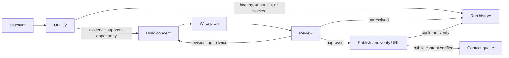

# SiteScout

SiteScout is a research assistant for an independent web designer. It discovers licensed painting businesses in the Los Angeles area, checks whether customers can reach them online, and prepares a website concept and a personalized outreach draft when the evidence supports one. Abraham decides whether to make contact.

**Open the operator desk** to see real businesses ready to contact, their verified preview links and the published ways to reach them. **Run discovery** starts live research. **Runs** lets you inspect a batch, play its recording, or try the ten-business rehearsal. **How it works** plays one business’s recorded path through the graph. A new checkout includes a fictional rehearsal that works without API keys.

The current [Paintastic concept](https://p-0caf0bac7bdc97792e.sitescout-previews-ec8f1c9e.pages.dev) uses six photographs from its matched Burbank listing. The [Tony Castaneda concept](https://p-587c6a9871c0e8ab16.sitescout-previews-ec8f1c9e.pages.dev) uses five verified Instagram work photos, each linked to its original post. The [fictional Copper Finch rehearsal](https://p-9231d3b1a6b4d6f7de.sitescout-previews-ec8f1c9e.pages.dev) shows a staged Instagram gallery. The [fictional Linen Leaf example](https://p-24d56f10492738e648.sitescout-previews-ec8f1c9e.pages.dev) demonstrates service selection and a testimonial carousel. On the prepared Mac, open the [ten-business rehearsal](http://127.0.0.1:8501/?replay=df631a0728b0) to see businesses take different paths.

## Open the desk

On Abraham’s prepared Mac, double-click **Open SiteScout.command** in Finder. It opens the running desk or starts it. You can also use these commands when the desk is closed. Open **http://127.0.0.1:8501** in a browser.

```sh
cd /Users/abe/agent/cmu-agentic-ai/sitescout-capstone
.venv/bin/streamlit run app.py
```

On a new Mac or Linux checkout, use Python 3.12 with SQLite FTS5 support. The following uses [uv](https://docs.astral.sh/uv/). Standard Python 3.12 with `python3.12 -m venv .venv` and `.venv/bin/python -m pip install -r requirements.txt` works too.

```sh
git clone https://github.com/Abraham21/sitescout-capstone.git
cd sitescout-capstone
uv venv --python 3.12
uv pip install -r requirements.txt
.venv/bin/streamlit run app.py
```

### Use the desk

| View | What you can do |
| --- | --- |
| Contact queue | Open a reviewed preview, choose a published email, phone or social profile, and read or edit the draft. The queue shows the most recent completed real result for each license. |
| Runs | Choose a recorded batch or follow a running one. Select a business in the activity list or use **Inspect business**. The detail panel follows your selection. Up to three businesses can be in progress. |
| How it works | Pick a business and play or step through its actual handoffs, including a skipped lead, a reviewer hold or a repair when present in the selected run. |

**Run discovery** selects unseen licenses. Under **Runs → Run options**, the live showcase researches three known real licenses from scratch, the rehearsal exercises ten fictional cases, and Daily autopilot controls the Mac’s schedule. A saved replay uses historical decisions and drafts. You can select and copy its text. Current reviewed drafts can be edited from the contact queue.

On a business, **Website preview** shows how it was customized. **Research & RAG** shows the research passages and which ones retrieval selected or the qualifier cited. **Agent trace** retains the handoffs and reviewer feedback. A person chooses whether and how to send each message.

## Read the code

Start with [pipeline.py](pipeline.py). Read `run_lead` from the node definitions through the graph edges. Each node returns the few fields it adds to the business record. Read `run_batch` second to see where the businesses and tools come from. To trace a hold, follow `search_business` → `inspect_site` → the return value of `qualify` in [research.py](research.py). To trace a published lead, follow `build_preview` → `write_pitch` → `review` in [studio.py](studio.py). The same graph powers the command line, dashboard and scheduled run. Its nodes and conditional edges follow the StateGraph pattern from Module 5.1. The researcher uses the course sample’s approach of bounded queries, deduplicated sources and direct page checks.



| File | Where to look |
| --- | --- |
| [research.py](research.py) | `discover` filters the public California CSLB file. `qualify` matches identities, checks possible sites and their estimate links, and retrieves evidence for the model. |
| [business_profile.py](business_profile.py) | Reads gallery photos, logos and attributed review text from matched business sources. Checks image type and size before embedding. |
| [studio.py](studio.py) | `build_preview` fills the painter template. `write_pitch` compares grounded openings. `review` rebuilds the HTML, verifies the claims and asks Gemini for a separate judgment. |
| [assets/painter.html](assets/painter.html) | The painter layouts display the business phone, verified services, available photos and sourced testimonials. Service cards lead to the estimate form and preselect the project type when the business offers multiple verified specialties. **Send request** demonstrates how the owner could activate inquiries. Contact details stay in the browser. The [painter skill](.agents/skills/painter-preview/SKILL.md) explains which facts and images may appear. |
| [services.py](services.py), [publication.py](publication.py) | The Gemini and Exa calls, followed by direct upload to Cloudflare Pages and a check of the HTML actually served. |
| [storage.py](storage.py), [autopilot.py](autopilot.py) | SQLite stores events, results, spending reservations and operator edits. macOS launchd schedules one batch per day when enabled. |
| [app.py](app.py), [desk_views.py](desk_views.py) | The Streamlit operator desk, recorded graph playback, and evidence inspection. |
| [evaluation.py](evaluation.py) | Reproduce fixture, retrieval, writing and blind-review measurements. |

### How a lead earns a preview

1. Discovery filters active, unexpired C-33 licenses in Glendale, Burbank, Pasadena and Los Angeles. Discovery matches trading names and cities in Yahoo Local’s painting directory to active licenses. It screens up to twice the batch size (at most 24 listings) for an exact business phone, specific services, photos or named reviews, and a website link. Businesses with public work and no listed website get first consideration. Within each group it rotates cities. If there are vacancies, it fills them from the registry. The qualifier still searches independently for an existing website. Only business fields used for research are retained. The filtered registry is cached for a day. [CSLB data portal](https://www.cslb.ca.gov/OnlineServices/DataPortal/)
2. The qualifier searches by identity, cross-checks by phone or license as needed, and opens plausible first-party sites. An exact labeled license, matching company name and business navigation can establish ownership on an abbreviated domain. A third-party license mirror never counts as the owner’s site. A verified site with a working published phone can pass the contact check. Repeated missing-page responses from an estimate link can establish a specific defect.
3. A social profile with a matching license and published work, or a directory listing with a matching phone, owner-described services and project photos or named testimonials, can support a portfolio concept. SiteScout first searches for an existing company website. When the opportunity comes from a public portfolio alone, the pitch describes what the new site offers. A specific defect claim requires evidence of that defect. When evidence is thin, a third search checks for a business profile with an outbound website or portfolio link. An unavailable linked domain gets a second check. The record keeps the listing, host observations and any mismatch for manual verification. Weak evidence goes on hold. Instruction-like source text can block the case.
4. **RAG** uses SQLite full-text search over a versioned evidence set for one business. Name, locality, contact and service queries retrieve passages. Gemini may extract explicitly cited services or flag a contradiction. A deterministic check requires the extracted wording to occur in the cited text.
5. The writer uses bounded **tree-of-thought-style search** when it has competing observations. It compares possible opening angles, shortlists up to two, and compares the resulting pitches. The trace shows inspectable alternatives and evidence IDs. Gemini Flash is the sole cloud model to keep the implementation small. The course project has too few independently labeled examples to justify fine-tuning; local inference is a future comparison.
6. The reviewer validates the actual preview and the draft. A failed review can send the lead back through the builder and writer twice. Cloudflare receives only the approved static preview. A content fingerprint must match at the public address before a draft enters the contact queue. The researcher shortlists up to six project photos from a verified company site or a matched listing. Its existing Gemini qualification request includes a numbered contact sheet. Gemini chooses the cover and describes unlabeled images. Original source references travel with the photos. If a visual choice is unavailable, the builder uses the size- and crop-ranked images. For a Yahoo Local gallery, it checks the business name, city, phone and original gallery URLs. SiteScout also reads public Instagram business bios and checks eligible posts belonging to the matched account. Selected photos keep their original post links. Attributed review quotes stay linked to their source. The template omits testimonials when no named review can be verified. Local or licensed design photography carries its own credit. The page identifies itself as an independent concept. [Asset credits](assets/CREDITS.md)

### Enable fresh research and hosting

Copy `.env.example` to `.env` **only on a new checkout**. On the prepared Mac, use the existing project-local `.env`. It is ignored by Git.

| Variable | Purpose |
| --- | --- |
| `GOOGLE_API_KEY` | Gemini Developer API access for the configured Flash model. |
| `EXA_API_KEY` | Exa Search access for web research. |
| `CLOUDFLARE_ACCOUNT_ID`, `CLOUDFLARE_API_TOKEN` | Account-scoped Cloudflare Pages edit permission for publishing, followed by ordinary public HTTP verification. |
| `SITESCOUT_PAGES_PROJECT` | Optional, globally unique Pages project name. Otherwise a short account-derived suffix identifies this project. |

For deployment, install a supported Node.js release (the prepared Mac uses Node 26) and run `npm ci` beside `package-lock.json`. Node is only needed for Wrangler uploads. Cloudflare supplies the shareable `pages.dev` addresses. The desk binds to localhost. Preview links are unlisted with a no-index directive and anyone with a link can open them. An operator can remove deployments from the preview project’s Deployments page in Cloudflare.

```sh
.venv/bin/python pipeline.py --mode showcase --limit 3
.venv/bin/python pipeline.py --mode live --limit 10
.venv/bin/python pipeline.py --recheck PREVIOUS_REAL_RUN_ID
```

On macOS, **Daily autopilot** registers a 9:00 AM local launchd job for ten unseen businesses. Keep the Mac signed in and online. Switching it off unregisters the job. One batch lock prevents overlapping work. Results and logs survive a closed dashboard. Daily operation is opt-in. Hosted previews remain available when the Mac is offline.

## Evaluation and reproducibility

One operator independently judged the first release on five selected real businesses. Website ownership agreed on **5/5** and the proposed action on **4/5**. The one draft needed editing. A directory link supplied by the operator exposed a follow-up the original search missed. That input and a request for more useful sites drove the redesign. In a later walkthrough, the operator accepted the message and would withhold the morning website. The split headline, lack of on-page project photos and copy-only estimate interaction informed the next revision. [Operator evaluation](evaluation/operator-review.json)

On 15 authored synthetic cases with known labels, the deterministic qualifier matched all 15 expected routes. It held eight cases, skipped three, qualified three and blocked one. It labeled none of six known websites missing. Retrieval recovered all 12 authored decisive passages in both arms, using 5,439 characters with FTS versus 12,025 with full context. This benchmark measures regression behavior on visible examples. [Fixture results](evaluation/results.json)

In the revised two-case paid writing comparison, both approaches selected the same opening in both cases. Direct writing took one call per case (2.51–2.60 seconds). The branching approach took two calls (4.04–5.18 seconds). The ten-call study, including the qualification comparison, cost $0.006831. The small study does not establish a preference for branching. [Paired results](evaluation/paired-pitches.json) · [Initial pilot](evaluation/initial-paired-pilot.json)

### Ordinary discovery after the operator walkthrough

Each row below represents ten distinct businesses. The rechecks repeated live research on the same ten. Contact-ready includes both email drafts and manual follow-ups with a verified preview.

| Group | Contact-ready on first pass | Contact-ready on recheck | Other outcomes on latest pass |
| --- | ---: | ---: | --- |
| Batch the operator inspected | 0 | 2 | 3 skips, 5 holds |
| New registry-first batch | 0 | 1 | 2 skips, 7 holds |
| New batch prioritizing name-and-city directory matches | 0 | 0 | 4 skips, 6 holds |
| New batch prioritizing verified public portfolios | 0 | 3 | 5 skips, 2 holds |
| Next unseen batch after the directory-reader correction | 0 | — | 1 skip, 9 holds |

In the last batch, discovery found two unseen directory matches. Eight places came from the license registry alone. A license establishes eligibility, while a preview also needs customer-facing evidence and a published contact path. This four-city source produced uneven yields. The first four cohorts informed changes during development. [Run measurements and cohort membership checks](evaluation/observed-runs.json) · [Audit of the remaining original holds](evaluation/held-lead-audit.json)

The ranked cohort recheck found three manual-contact opportunities in 29 seconds. The [Alexander Clark preview](https://p-4cf7565fb74df3b89f.sitescout-previews-ec8f1c9e.pages.dev) uses six sourced images and four attributed reviews. The [Chris Christofi preview](https://p-c56eb303a84382408e.sitescout-previews-ec8f1c9e.pages.dev) uses three images and one attributed review. In the original cohort, the researcher independently found Tony’s verified Instagram and email, BE Painting’s Facebook profile and email, and McCormick-JWC’s business website.

### Earlier baseline

| Morning recorded run | Output | Elapsed¹ | Search + inference² |
| --- | --- | ---: | ---: |
| Ordinary discovery, ten unseen actual contractors | 1 healthy-site skip, 9 holds | 15.1 s | $0.1680 |
| Curated live showcase, three actual contractors | 1 reviewed manual-contact draft with a verified site, 1 hold with a directory-linked domain to check, 1 skip | 16.4 s | $0.0445 |
| Frozen rehearsal, three synthetic contractors | 1 reviewed email, 1 manual contact, 1 skip, 2 verified sites | 17.9 s | $0.0029 |

¹ From the first through the last recorded event with a warm registry. Internet latency varies. ² Exa-reported search costs plus inference estimated from provider token usage. A first calibration pass misidentified license directories as owned sites. Strengthening the ownership check changed six records from skip to hold in the ten-record retest. The [recorded run measurements](evaluation/observed-runs.json) contain event times, provider call counts and outcomes. The curated example demonstrates feasibility. The samples are too small to predict daily yield or throughput at 100 businesses per day.

```sh
uv pip install pytest==9.2.0
.venv/bin/python -m pytest -q
.venv/bin/python evaluation.py --fixtures
```

The earlier three-license Paintastic showcase started from registry IDs alone. It independently found the gallery, selected a cover, described six photos, published the reviewed concept and routed the draft to manual contact. The ten-business synthetic rehearsal produced three verified sites. Browser checks cover gallery navigation, responsive headlines and a local estimate-form submission. [Browser and media checks](evaluation/preview-checks.json)

The tests and fixture benchmark need no live service. Optional `--paired-pitches` makes metered Gemini calls and writes a new pilot. `--blind-cards` assembles two local HTML forms from five unique real records after discovery and showcase runs. Complete the routes form before the draft form. Each form downloads a JSON response file. Run `evaluation.py --score-blind PATH_TO_ANSWERS` for each response. The rating key stays in the operator’s private data directory.

Runtime data lives in `.runtime/` (override with `SITESCOUT_DATA_DIR`). Each metered call reserves its worst-case allowance in SQLite before dispatch. This checkout’s cumulative budgets are $3 for Gemini and $6 for Exa. They apply to calls through this application and to its configured data directory. Failed calls with an unknown charge retain the reservation. Replaying a run is always free.

## Capstone handoff

The morning submission drafts describe the earlier measured run. The [final report](submission/SiteScout%20Report.pdf) follows the course template. The [editable presentation](submission/SiteScout%20Presentation.pptx) contains speaker notes. The [recording guide](submission/SiteScout%20Recording%20Guide.docx) includes an 8:55 technical walkthrough and an optional 90-second pitch. After recording, paste the shareable video link into the [Canvas submission document](submission/SiteScout%20Canvas%20Submission.docx). The [evaluation guide](evaluation/README.md) explains the independent human review.
